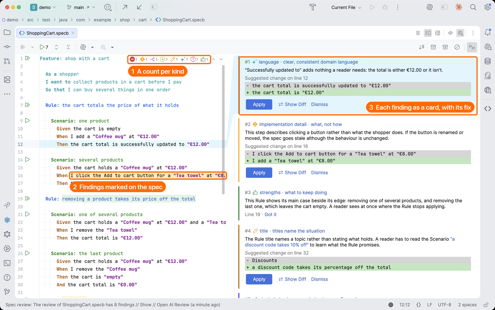
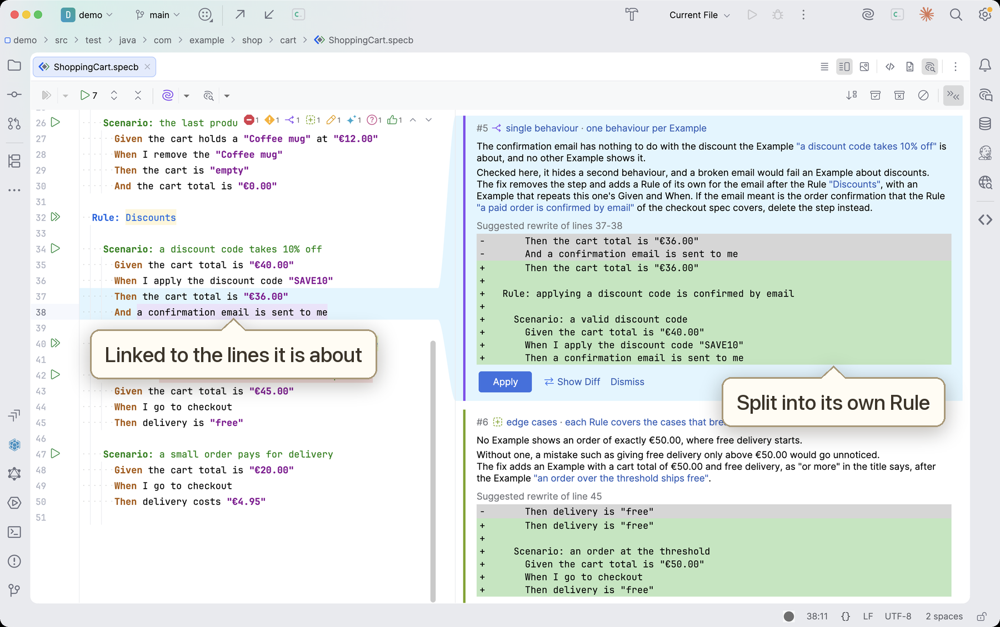
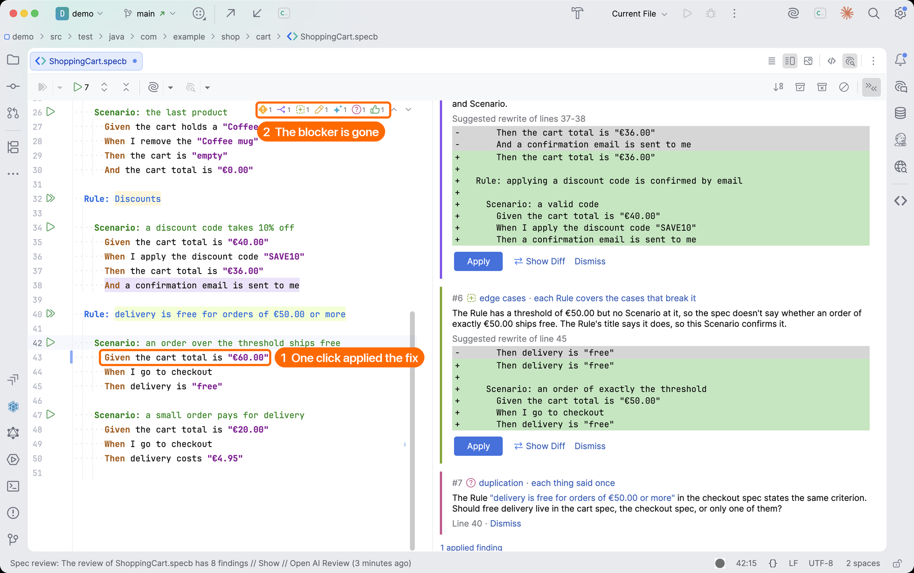
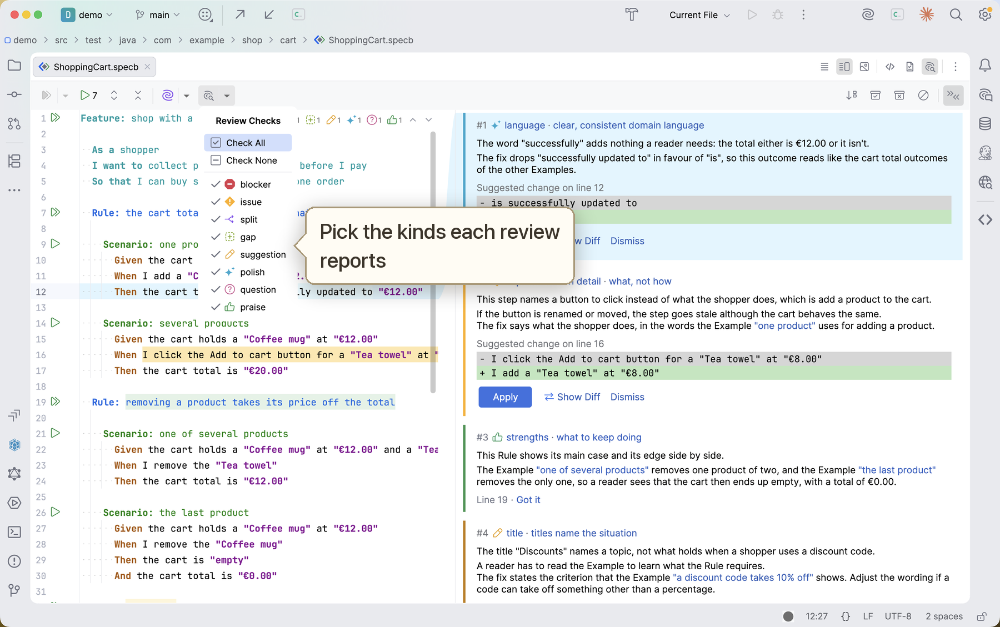
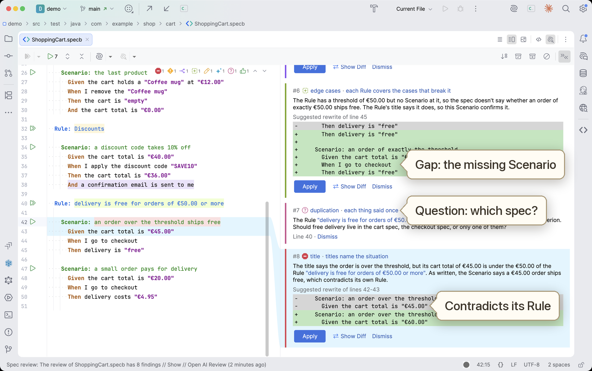
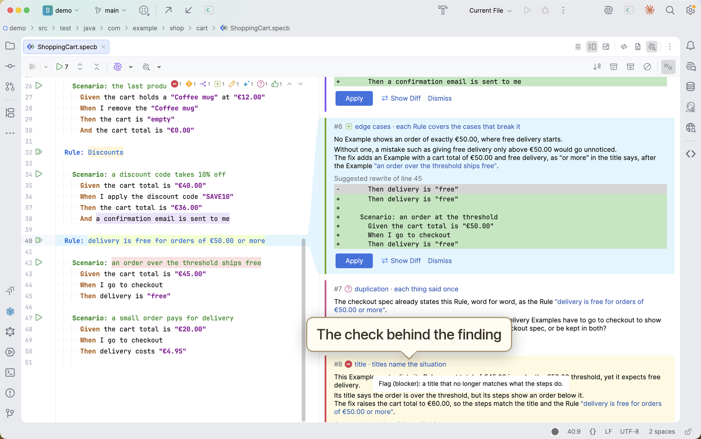

# SpecBinder skills for coding agents

A plugin for Claude Code and Codex that gives your coding agent skills for working with
[SpecBinder](https://specbinder.dev) Gherkin spec files (`.specb` / `.feature`): reviewing them, turning them into
running tests, and splitting them when they cover too much. Its review checks a spec against your project's
guidelines, which you can start from the starter guidelines it offers. The findings appear in the spec editor of
IntelliJ IDEA, where you can apply or dismiss them, or go through them with the agent in the same session.
[All skills](#skills) are listed below.

https://github.com/user-attachments/assets/0d52355f-a508-4166-817b-c7bbf325c2d1

## Requirements

- Claude Code or Codex.
- IntelliJ IDEA 2025.2 or later, with the [SpecBinder plugin](https://plugins.jetbrains.com/plugin/30540-specbinder-beta-)
  2026.20.0 or later installed.
- The IDE's MCP server enabled, with your agent connected to it. See the next section.
- For the skills that wire and run tests (`automate-spec`, `restructure-spec-folders`), and for moving test code in
  `split-spec`: a Java project built with Maven or Gradle.

## Setup

1. In IntelliJ IDEA, open **Settings › Tools › MCP Server** and enable the server. Click **Auto-Configure** for
   your agent if it is listed; otherwise add the server's address from that page to your agent's MCP
   configuration. Restart the agent so it picks up the connection.
2. Install the plugin, then restart the agent. Its MCP server list should now show the IDE's server with the
   `specbinder_*` tools on it.

   Claude Code:
   ```
   /plugin marketplace add dmytro-stasyuk/spec-binder-skills
   /plugin install specbinder@specbinder
   ```
   Codex:
   ```
   codex plugin marketplace add dmytro-stasyuk/spec-binder-skills
   codex plugin add specbinder@specbinder
   ```

## Usage

To see a review before writing your own specs, open the [`demo`](demo/) project in IntelliJ IDEA and review its
cart spec: it is written to draw all eight kinds of finding.

Ask for a review in your agent's session. In Claude Code:

```
/specbinder:review-spec src/test/java/com/example/cart/Checkout.specb
```

In Codex, call the skill by its plain name, `review-spec`, or just ask ("review Checkout.specb").



The agent reads the spec as the editor has it, reviews it and publishes its findings. Each finding is one of
eight kinds, from most to least serious: **blocker**, **issue**, **split**, **gap**, **suggestion**, **polish**,
**question** and **praise**. It is marked on the text it is about in that kind's look, and the agent lists the
findings by number in the chat. Each kind has its own colour under **Settings › Editor › Color Scheme › General ›
Errors and Warnings** ("SpecBinder review: …") and its own count in the editor's top-right problems widget, and
its own group in the Problems tool window. Each also gets a card in the spec's **AI Review** tab, beside the spec
in split view, linked to its text. The tab is on unless you turn it off under **Settings › SpecBinder › Split
view**. From there you can:

- ask the agent to explain or fix a finding ("fix #2 and #3"), in the chat;
- apply the proposed fix, or dismiss a finding, from its card or Alt+Enter on its text. A fix is either a new
  wording for the quoted text or a rewrite of whole lines, shown as a diff on the card;
- edit the text yourself. The finding goes away once the text it quotes changes.





The **Review This Spec** button on the spec's toolbar asks for a review in one click: it sends the review command
to the spec's open Claude Code session, or starts one for the spec when none is open. With another agent, ask for
the review in its session. When the review is ready, **Show** on the IDE's notification opens the AI Review tab at
the first finding. The button's arrow, and a toggle per kind on the AI Review tab's toolbar, list the eight kinds
with a tick each. Untick a kind to leave it out of the spec's next review and set its current findings aside; tick
it again to bring them back. **Check All** and **Check None** pick quickly, and a spec you haven't chosen for
starts from your last selection. Naming kinds in the request itself ("review Cart.specb for blockers and issues
only") overrides the ticks for that review.



### More from a review

- When the **gap** kind is ticked, the review also works through each Rule for missing edge cases: boundaries,
  empty or missing input, errors, permissions, state and ordering, concurrency and time. Each gap comes with
  the missing Scenarios written out as its fix, ready to apply. It needs an `edge-cases` category in the project
  guidelines (see below), where you can add your own domain's edge cases.

  

- When you push back on a finding ("HTTP endpoints are fine in our specs"), the agent offers to add that as a
  guideline to your project's guidelines, so later reviews follow it.
- The starter guidelines include SpecBinder's layout and wording conventions, under the `format` category. Most
  of them are **polish**, so unticking that kind leaves them out.

## Skills

Run a skill as `/specbinder:<name>` in Claude Code or by its plain name in Codex, or just describe what you want
("review Cart.specb") and the agent picks the skill. Skills that work on one spec take its path, or else use the
file and cursor position from the IDE.

**Turn specs into tests (Java)**

| Skill | What it does |
|---|---|
| `automate-spec` | Wires a spec to a JUnit 5 test and writes step methods that exercise the production code the way the project's existing specs and tests do, reusing its existing steps. Runs the tests and reports. A step the code can't support yet fails with a message saying what's missing. |

**Restructure specs**

| Skill | What it does |
|---|---|
| `restructure-spec-folders` | Restructures the spec folders so they reveal what the system does: by default by business capability and use case, never by technical layer or test type; or by a principle you give; or just tidies them. Moves each spec with its test class and the test code it shares, shows the plan first and rebuilds afterwards. |
| `split-spec` | Moves the top-level Features of a spec file that holds several into spec files of their own, rewriting the links between them. In a Java project it also creates the new test classes, sorts the step methods between them and rebuilds. |

## Project guidelines

A review checks a spec against your project's guidelines only: `.specbinder/review-guidelines.md`, and any
number of `.md` files in a `.specbinder/review-guidelines/` directory (subdirectories included). Nothing is
checked that isn't written there. A project without guidelines gets no review: the agent offers to set them up
first.



To start, ask the agent to set up review guidelines, or just ask for a review. It offers the starter guidelines
in [`skills/review-spec/starter-guidelines/`](skills/review-spec/starter-guidelines/), one file per category:
`user-perspective`, `implementation-detail`, `declarative-steps`, `structure`, `single-behaviour`, `title`,
`language`, `edge-cases`, `duplication` and SpecBinder's `format` conventions. Take all of them, pick some, or write your own.
The ones you pick are copied into `.specbinder/review-guidelines/` and are yours from then on: edit them, delete
checks, add categories. Later changes to the starter guidelines don't reach your copies.

Files are read in path order, the single file first, and where two files disagree, the later one wins. The
guidelines are written in sections: a level-2 heading, a `Kind:` line, which every section needs, and bullets. A
bullet starting with `Flag:` is a check, naming what the review reports; other bullets are guidance for the
section's checks. A heading with a name in backticks, ``## `name` ``, makes its section a category, and its
findings show that name; any other section, including the part of a file before its first heading, has no category.
A single check can be reported as a different kind than its section's, as `- Flag (polish): ...`. The kind must be
one of the eight above, since each is shown in its own way in the IDE. A review doesn't run while a section lacks
its `Kind:` line or a kind isn't one of the eight: the agent names the file and line and offers to correct it. Each
finding has the kind of the check it comes from, and the agent reports nothing your guidelines don't check for:

```markdown
## `accessibility` — every user can complete the task

Kind: issue

- Flag: outcomes that are only shown by colour or only conveyed by sound.
- Flag (polish): images in a doc string without a description.

## Pricing

Kind: suggestion

- Flag: prices without a currency.
```

A review loads only the files that have checks of the kinds it reports, as ticked in the IDE.

## Acknowledgements

How a review words its findings, in plain words and a human voice, draws on Matt Wynne's
[`talking-to-humans`](https://github.com/mattwynne/skills/tree/main/skills/talking-to-humans) skill, and through it
on Giles Turnbull's essays [Use the words normal people would use](https://gilest.org/notes/normal-words.html) and
[Use the human voice, not the corporate voice](https://gilest.org/notes/human-voice.html).

## License

[GNU General Public License v3.0](LICENSE), the same as the SpecBinder library.
